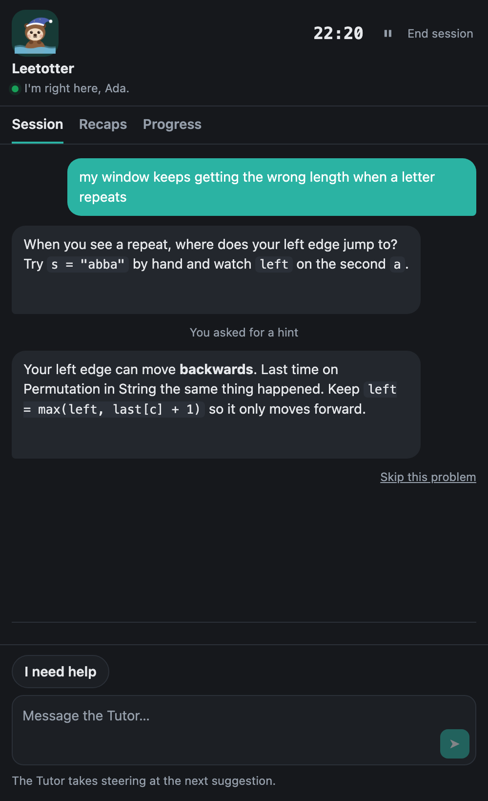
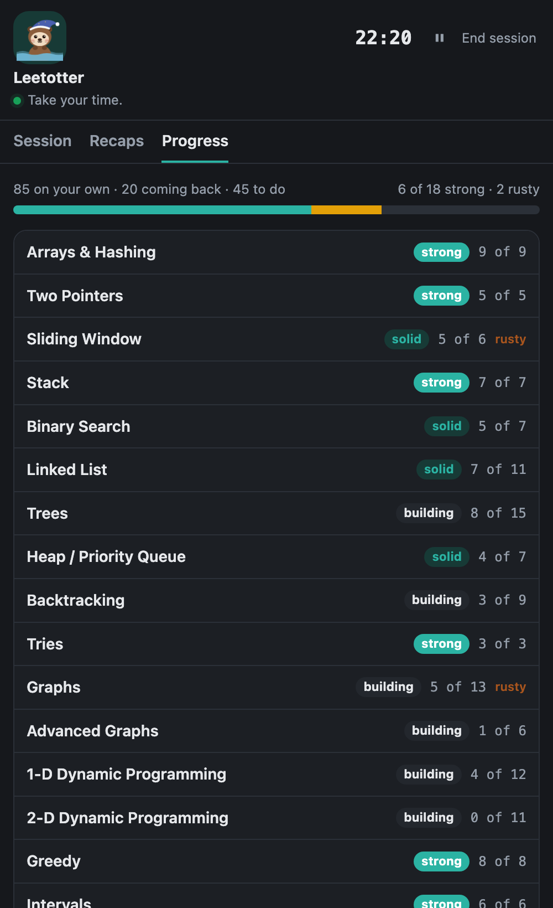

<div align="center">


# Leetotter

**An AI tutor for the NeetCode 150 that remembers how you did.**


&nbsp;&nbsp;

</div>

A chatbot in the sidebar helps with one problem, then forgets you. Leetotter sits beside NeetCode's editor in Chrome and keeps track of what you solved, where you slipped and what to do next.

| | Chatbot | Leetotter |
|---|---|---|
| Remembers your past mistakes | ✗ | ✓ |
| Picks your next problem | ✗ | ✓, spread across categories |
| Brings problems back before you forget them | ✗ | ✓, spaced repetition (FSRS) |
| Waits for you to ask before hinting | rarely | always |
| Shows what you can solve on your own | ✗ | ✓, per category |

## Features

- **Plans your practice.** Steer it in plain words: "something harder", "more graphs".
- **Hints like an interviewer.** Only when you ask, and only as much as you need. After a solve it may ask about complexity.
- **Learns how you think.** It spots patterns in your mistakes and uses them to plan and teach.
- **Private by default.** It watches only during a session, never runs your code, and keeps your history in one file on your Mac.

## Get started

You need macOS, Chrome, Python 3.14 with [`uv`](https://docs.astral.sh/uv/), Node.js, and an API key for any OpenAI-compatible model provider. NeetCode must be set to Python.

```sh
git clone https://github.com/joshualumzy/leetotter && cd leetotter
security add-generic-password -a "$USER" -s NUS_SOCLAAS_API_KEY -w   # paste your API key
./scripts/install.sh --base-url 'https://your-provider.example/v1'
cd extension && npm install && npm run build
```

In Chrome, open `chrome://extensions`, turn on Developer mode, choose **Load unpacked** and pick `extension/dist`. Then open Leetotter from Chrome's side panel on any NeetCode page.

The full setup, testing and uninstall notes are in [docs/development.md](docs/development.md).

## License

MIT. See [LICENSE](LICENSE).
